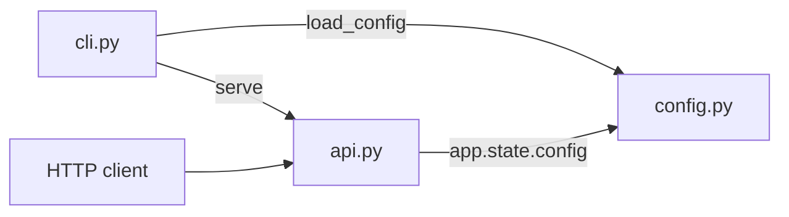

# Architecture Internals

How e2e-throwaway works inside: for contributors, reviewers and AI assistants. User-facing behaviour belongs on the other pages.

## Overview

`e2e-throwaway` is a small FastAPI service with a Typer command line. Both entry points load the same `Config` from `config.py`; `serve` builds the app with `api.create_app(config)` and runs it under uvicorn.

## Components

| Module | Responsibility |
|---|---|
| `e2e_throwaway/__init__.py` | Package version |
| `e2e_throwaway/config.py` | Settings and their precedence (`_FILE` > env > file > default) |
| `e2e_throwaway/cli.py` | The `e2e-throwaway` command (Typer) |
| `e2e_throwaway/api.py` | The HTTP API (FastAPI): health, readiness, version |

`e2e_throwaway/__main__.py` is the `python -m e2e_throwaway` entry point and calls `cli.main()`. There are no other modules yet; add each new one to the table above.

## Data flow

A request arrives at uvicorn (started with `proxy_headers=True`) and is routed by FastAPI to a handler in `create_app`. The handlers (`/healthz`, `/readyz`, `/version`, `/hello`) return small JSON objects and keep no state: nothing is cached and nothing is written to `state_dir` yet. Configuration is read once at startup; changing it needs a restart. An invalid configuration stops startup with a one-line error and exit code 2. `/readyz` currently always answers ready; a dependency check that fails would turn it into a 503.

## Design decisions

Why things are the way they are is recorded in [docs/design/](https://github.com/metalayerlab/e2e-throwaway/tree/main/docs/design). Rejected ideas and the reasons are in [TODO.md](https://github.com/metalayerlab/e2e-throwaway/blob/main/TODO.md) under "Decided against".

There are no design records yet beyond the template (see the index in `docs/design/README.md`). The decisions that shape the code today: a single `SETTINGS` table drives configuration, the generated wiki tables and `e2e-throwaway config`; secrets only come from `_FILE`; liveness stays dependency-free.
